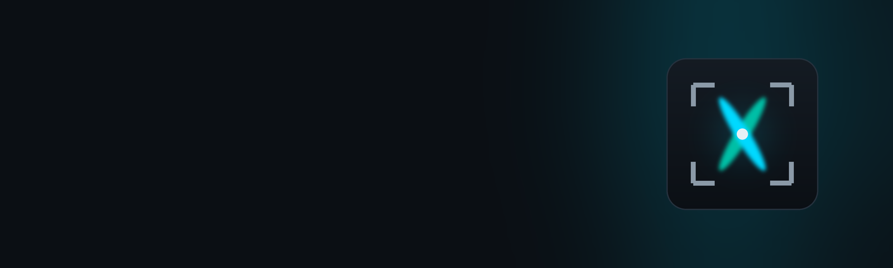

<div align="center">



# Synapse X — AeroTwin

&nbsp;
&nbsp;


[**Prebuilt App (`APP/Synapse X.exe`)**](APP/) &#8226;
[**Features**](#features) &#8226;
[**Pipeline Architecture**](#pipeline-architecture) &#8226;
[**Build from Source**](#build-from-source)

</div>

**Synapse X (AeroTwin)** is a standalone, native C++ 3D Gaussian Splatting and spatial digital-twin reconstruction engine. It transforms raw multi-view imagery, aerial/drone footage, and 360° video into photorealistic 3D Gaussian Splats and textured meshes inside a single self-contained binary — with zero runtime dependency on Python, PyTorch, or external COLMAP installations.

Engineered for cross-vendor GPU acceleration via Vulkan (NVIDIA, AMD, Intel, and Apple Silicon) as well as CUDA, Synapse X trains up to 10 million full-SH Gaussians within 8 GB of VRAM and natively supports pinhole, fisheye, and 360° equirectangular camera models.

---

## Features

- **Cross-Vendor GPU Compute** &ndash; Runs natively on **NVIDIA, AMD, Intel, and Apple Silicon** GPUs through a unified Slang/SPIR-V Vulkan compute backend, plus a native CUDA backend.
- **Unified MCMC / IGS+ / MRNF Densification** &ndash; Combines the strengths of modern densification strategies for sharper geometric detail and significantly fewer floaters across both object captures and large-scale aerial/scene reconstructions.
- **Extreme VRAM Efficiency** &ndash; Quantized gradient and attribute storage enables training up to **10 million SH3 Gaussians in 8 GB VRAM**.
- **End-to-End Native Reconstruction Pipeline** &ndash; Built-in GPU video frame extraction, **SAM 2 / SAM 3 AI masking**, lightning-fast **native Structure from Motion (SfM)**, monocular geometry priors (**MoGe-2** and **Metric3D v2**), and **Delaunay 3D mesh extraction**.
- **Telemetry & Metric Scale Recovery** &ndash; Automatically parses embedded camera and flight telemetry metadata from video and image containers to recover true metric scale and gravity-aligned orientation.
- **Photometric Consistency** &ndash; Modified **Bilateral Grid** and **PPISP** per-frame exposure and white-balance modeling prevent color shifts and darkening across variable lighting conditions.
- **Native 360° & Fisheye Camera Support** &ndash; Train directly on equirectangular, GoPro MAX `.360` EAC, and wide-angle fisheye captures without lossy perspective undistortion.
- **Real-Time Desktop GUI & Embedded Web Viewer** &ndash; Includes a hardware-accelerated desktop studio, a full CLI workflow for headless/cloud servers, and an embedded HTTP + WebGL2/WASM viewer (`SynapseX Viewer` & `SynapseX Telemetry Viewer`).

---

## Quick Start

### Prebuilt Windows Application

A ready-to-run Windows executable is included in the repository under [`APP/Synapse X.exe`](APP/):

1. Clone the repository with [Git LFS](https://git-lfs.com/) enabled:
   ```bash
   git lfs install
   git clone https://github.com/rohzyy/Synapse-X-AeroTwin.git
   cd Synapse-X-AeroTwin
   ```
2. Launch `APP\Synapse X.exe` directly to open the interactive **SynapseX** desktop interface.

### Command-Line Interface (CLI)

The single executable dispatches all pipeline stages via subcommands:

```bash
# Open the interactive desktop GUI
"APP/Synapse X.exe"

# Run end-to-end Structure from Motion (SfM) on an image/video directory
"APP/Synapse X.exe" sfm auto --input <dataset_path>

# Train a 3D Gaussian Splatting model (serves live web viewer over HTTP)
"APP/Synapse X.exe" train --data <dataset_path>

# Run AI segmentation / dynamic object masking & sharp frame extraction
"APP/Synapse X.exe" sam segment --input <dataset_path>

# Estimate monocular depth and surface normal priors
"APP/Synapse X.exe" geometry --data <dataset_path>

# Extract a textured triangle mesh from a trained splat checkpoint
"APP/Synapse X.exe" mesh --input <checkpoint_path>
```

---

## Pipeline Architecture

```
Raw Video / Multi-View Images / 360° Captures
  │
  ├─► 1. Frame Extraction & AI Masking (GPU Video Decode + SAM 2 / SAM 3)
  │
  ├─► 2. Structure from Motion (SIFT / ALIKED + LightGlue / LoMa + GPU Bundle Adjustment)
  │
  ├─► 3. Geometry Priors (MoGe-2 Point Maps & Normals / Metric3D v2)
  │
  ├─► 4. 3D Gaussian Splatting Trainer (3DGS / Mip-Splatting / 3DGUT + PPISP / Bilateral Grid)
  │
  └─► 5. Textured 3D Mesh Extraction & WebGL2 / WASM Real-Time Inspection
```

---

## Build from Source

Synapse X supports two interchangeable compute backends:

| Backend | GPU / Vendor Support | Platform Support | Dependencies | Capabilities |
|---------|----------------------|------------------|--------------|--------------|
| **Vulkan** *(Recommended)* | NVIDIA, AMD, Intel, Apple Silicon | Windows, Linux, macOS | Vulkan SDK (or MoltenVK), CMake, Ninja | Full training, meshing, native SfM, GPU video extraction, AI masking, depth/normal inference |
| **CUDA** | NVIDIA GPUs | Windows, Linux | CUDA Toolkit, CMake, Ninja | Core training and meshing pipeline |

<details>
<summary><b>Building with the Vulkan Backend</b></summary>

<br/>

Ensure the Vulkan SDK is installed (on macOS, MoltenVK is fetched automatically by CMake).

### Windows (MSVC)

```bat
cd Synapse-X-AeroTwin
.\build_develop.bat -DSS_BACKEND=vulkan -DSS_ENABLE_PATENTED=ON
```

### Windows (Clang / GCC + Ninja)

```bat
cd Synapse-X-AeroTwin
cmake -G Ninja -B build -DCMAKE_BUILD_TYPE=Release -DSS_BACKEND=vulkan -DSS_ENABLE_PATENTED=ON -DCMAKE_MAKE_PROGRAM=Ninja
cmake --build build -j
```

### Linux

```bash
cd Synapse-X-AeroTwin
bash build_develop.bash -DSS_BACKEND=vulkan -DSS_ENABLE_PATENTED=ON
```

### macOS

```bash
cd Synapse-X-AeroTwin
bash build_develop.bash -DSS_BACKEND=vulkan -DSS_ENABLE_PATENTED=ON
```

### Third-Party Codec & Model Notes

- `-DSS_ENABLE_PATENTED=ON` enables hardware-accelerated GPU video decoding (`VK_KHR_video_decode_*`). When disabled (the default), video frame extraction falls back to `ffmpeg`.
- AI segmentation downloads SAM checkpoints on demand upon first use and caches them locally.

</details>

<details>
<summary><b>Building with the CUDA Backend</b></summary>

<br/>

Ensure a recent CUDA Toolkit and a compatible host C++ compiler are installed.

### Windows

```bat
cd Synapse-X-AeroTwin
.\build_develop.bat -DSS_BACKEND=cuda
```

### Linux

```bash
cd Synapse-X-AeroTwin
bash build_develop.bash -DSS_BACKEND=cuda
```

</details>

---

## License

This project is licensed under the [GNU General Public License v3.0](LICENSE).
